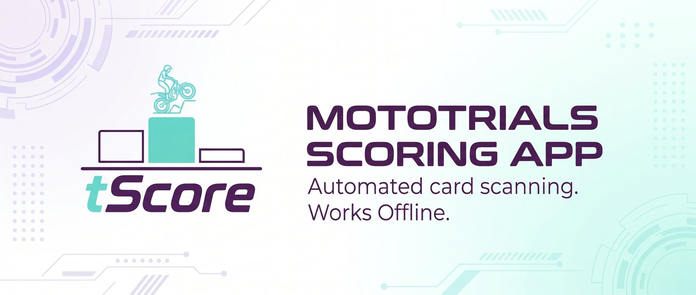

<p align="center">
  
</p>

# tScore

**Free, open-source scoring for motorcycle trials, built for club volunteers at venues with no internet.**

> **Status: pre-alpha.** tScore is in early development and not yet ready for events.
> Follow progress in [Releases](https://github.com/offdarecord/tScore/releases) and the
> [changelog](CHANGELOG.md).

tScore is a Windows desktop app that:

1. **Scores trials events.** Single or multiple days, classes, sections and laps; DNF/DNS, penalties,
   second classes and sidecars; results ranked with the usual tie-breaks.
2. **Reads punched observer scorecards** with a cheap USB document camera, so nobody types
   scores. Only cards that need a human go to a review queue.
3. **Handles pre-event work.** Imports the online entry list, generates rider numbers, and
   prints card labels with a QR code.
4. **Publishes results** as PDF, CSV and JSON, and later directly to results sites, queued
   offline and sent when back in reception.

Everything works offline. Every score traces back to a card image and an audit log.

## For developers

Requirements: Windows 10/11 x64, [Node.js 24 LTS](https://nodejs.org/), Git.

```sh
git clone https://github.com/offdarecord/tScore.git
cd tScore
npm install
npm start
```

| Command            | What it does                                                               |
| ------------------ | -------------------------------------------------------------------------- |
| `npm start`        | Run the desktop app in development mode                                    |
| `npm test`         | Unit tests                                                                 |
| `npm run test:e2e` | Launch the real app and click through it (Playwright, accessibility check) |
| `npm run check`    | Lint, format check, type-check and tests (what CI runs)                    |
| `npm run dist`     | Build the Windows installer into `apps/desktop/release/`                   |

### Layout

| Path              | What                                                             |
| ----------------- | ---------------------------------------------------------------- |
| `packages/core`   | Event model, scoring, ranking, results. Pure TypeScript          |
| `packages/vision` | Card reading. Pure TypeScript; runs in Node and in a Web Worker  |
| `apps/desktop`    | Electron app: main process, preload, React + Mantine UI          |
| `schemas/`        | JSON Schemas for tScore's file formats (MIT)                     |
| `assets/`         | tScore artwork (banner) for the README and project pages         |
| `presets/`        | Class lists, rulesets, label templates, card profiles, as data   |
| `fixtures/`       | Anonymised test data: card images, golden events                 |
| `docs/adr/`       | Architecture decision records: _why_ things are the way they are |
| `.claude/skills/` | Maintainer workflows for Claude Code                             |

Read [CONTRIBUTING.md](CONTRIBUTING.md) before opening a pull request.

## Licence

- Application: [Apache License 2.0](LICENSE) (see also [NOTICE](NOTICE)).
- File formats in `schemas/`: [MIT](schemas/LICENSE).
- Documentation in `docs/`: [CC BY 4.0](docs/LICENSE).
- The tScore logo, app icon and banner (`assets/`, `apps/desktop/build/icon.*`): **all rights
  reserved**, not covered by the licences above ([details](assets/LICENSE)).

"tScore" is the name of this project; modified versions should use a different name and their
own icon.
