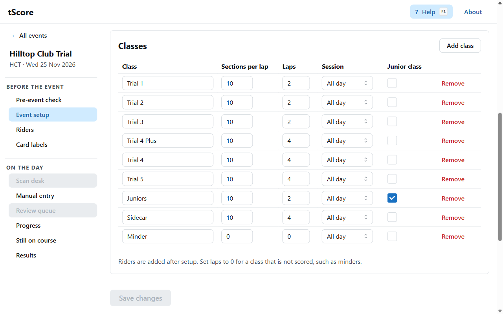
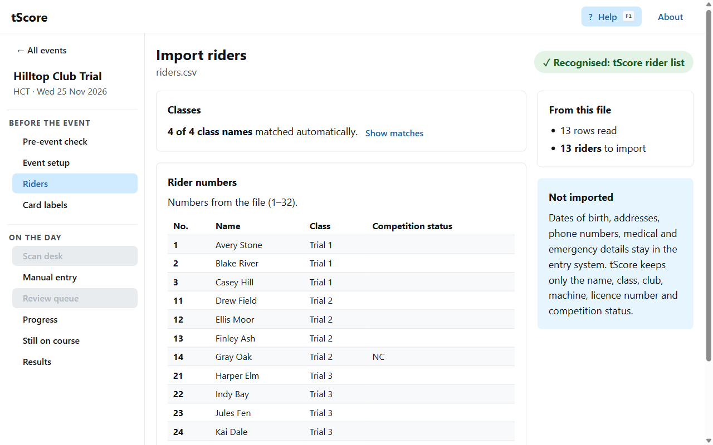
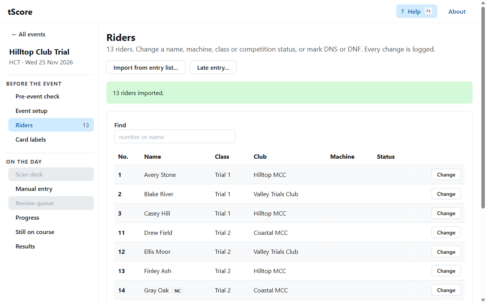
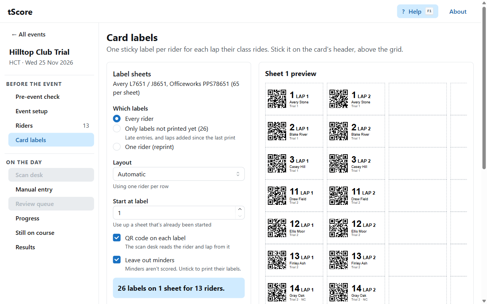
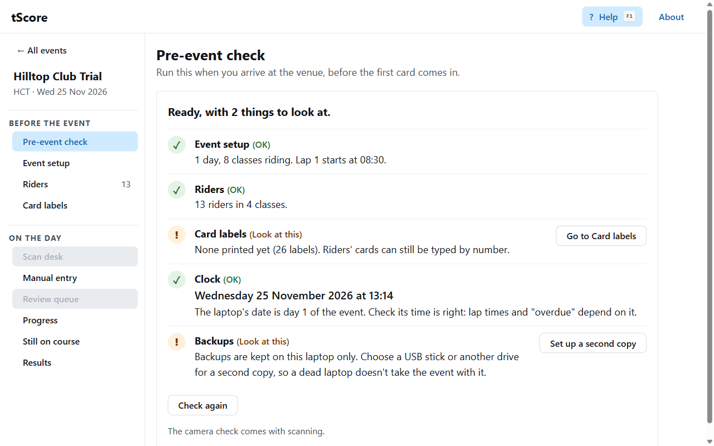
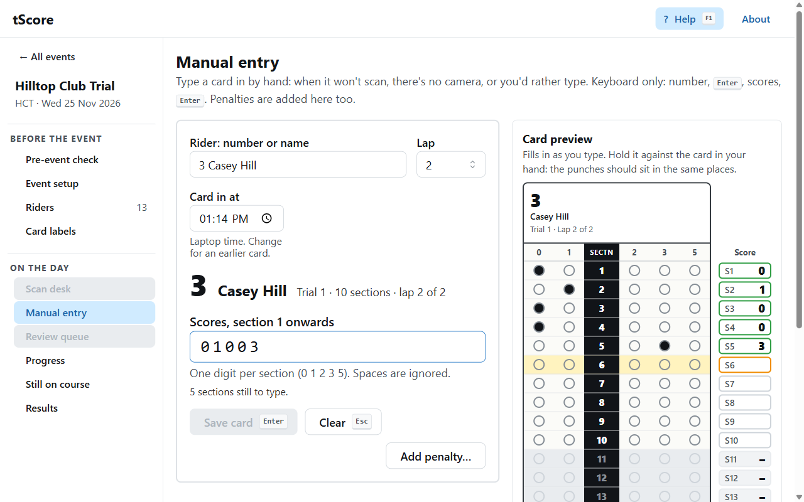
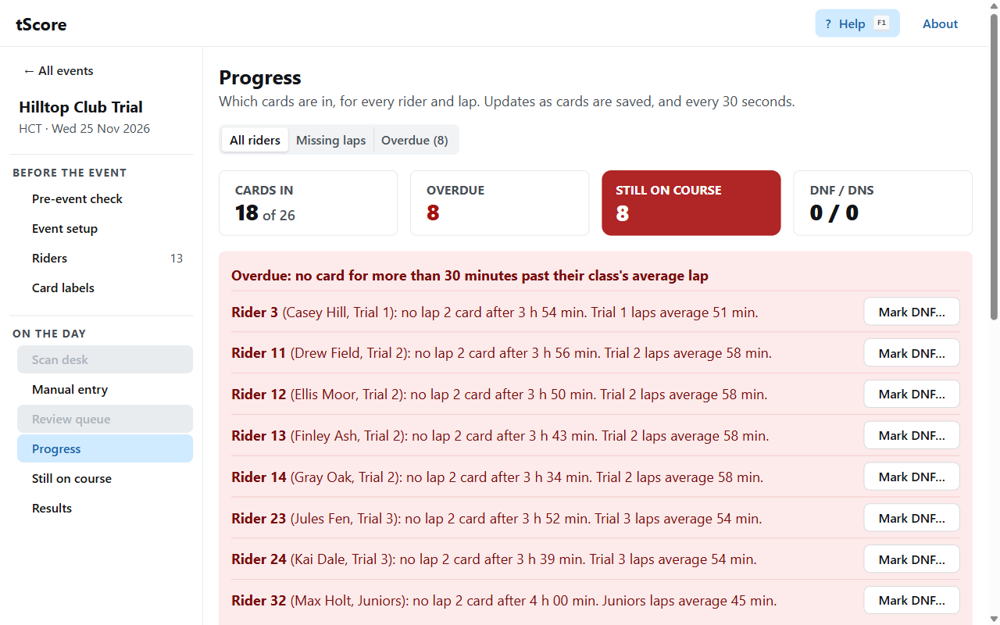
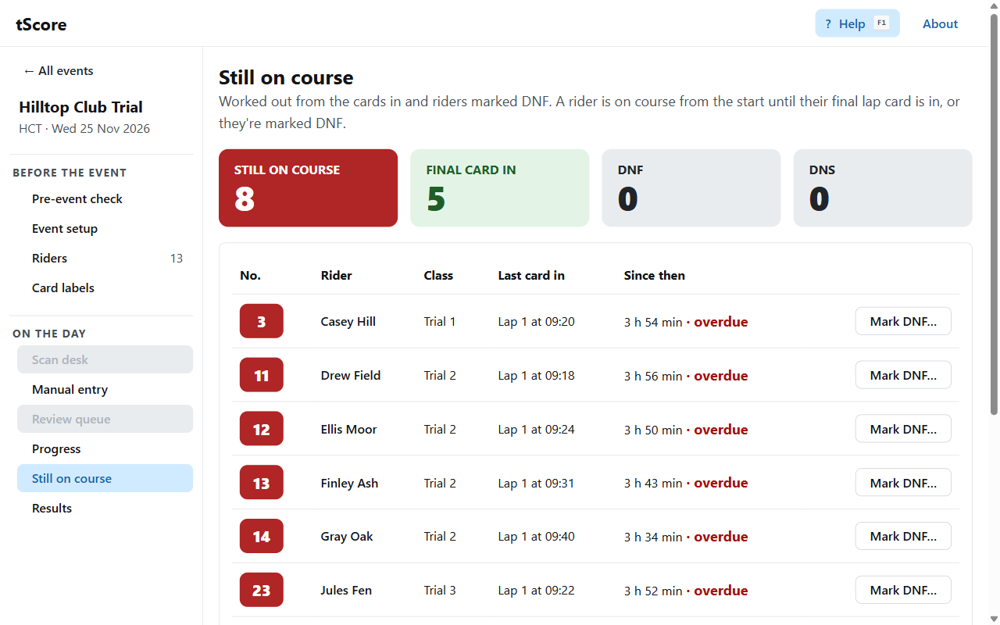
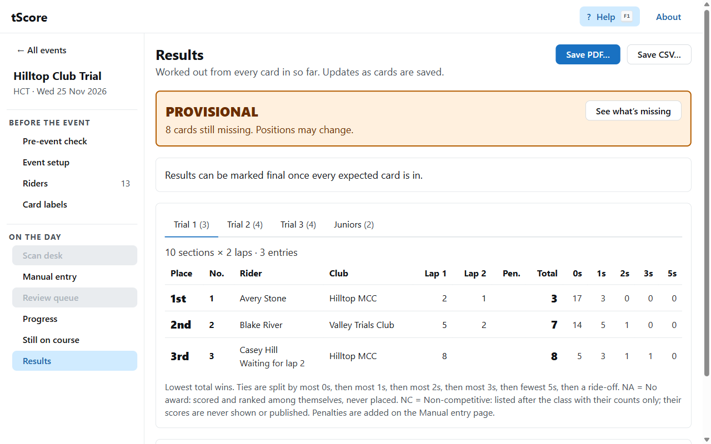
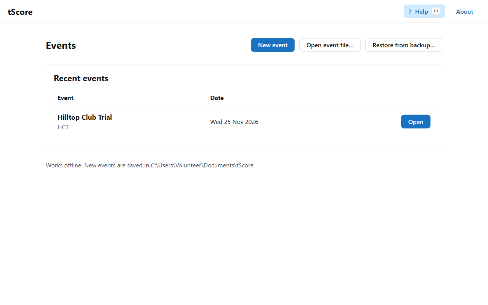

# A tour of tScore

What tScore looks like at each step of a club trial. The pictures use an invented event: the
riders, clubs and scores are made up. They're made by `npm run screenshots` from the real app,
so they show the current version.

## Before the event

### Event setup

Name, date and the classes with their sections and laps. Help sits under each box. Changes are
saved as they're made, with automatic backups.

### Import the entry list

Export the entry list from Ridernet or Entryplace and import it. tScore recognises the file,
shows what it found and asks only about anything unclear. It keeps only what scoring needs.

### Riders

Everyone entered, by class and number, with late entries and name or machine changes at the desk.

### Card labels

Print a label for every rider's card for every lap, with a QR code the scanner reads, on standard
label sheets (Word document, so any printer works).

### Pre-event check

One screen that says whether the event is ready: classes, riders, labels, backups.

## On the day

### Manual entry

Type a card in with the keyboard alone: number, Enter, the scores as one string of digits,
Enter. The card drawing fills in as you type, to hold against the card in your hand.

### Progress

Which cards are in for every rider and lap, and who is overdue.

### Still on course

Who hasn't brought their last card in, for the Clerk of Course at the end of the day.

## Results

Results build up as cards come in, marked provisional until every card is in. Save them as a PDF
to print or post, or CSV for a spreadsheet. Mark them final when they're checked; a correction
afterwards is a new numbered revision.

## Everything stays on the laptop

tScore needs no internet at the venue. Each event is one folder in Documents, saved as each change
is made, with automatic backups and an optional second copy on a USB stick.
